<div align="center">


<a href="https://github.com/trhlow">
  
</a>

<p>
  <a href="https://evts.id.vn"></a>
  <a href="mailto:thlong190705@gmail.com"></a>
  
  
</p>

</div>

<br/>

<div align="center"></div>

<table>
<tr>
<td width="52%" valign="top">

Xin chào! I'm **Long**, an IT student at **Tra Vinh University** who builds backends the way production
expects them: invariants guarded twice, tests running against real infrastructure, and releases that
can prove where they came from.

Most of my work is **Java + Spring Boot** behind a React or Flutter client. I like the hard parts —
concurrency, auth, messaging, deployment — and I write the docs so the next person doesn't have to
reverse-engineer them.

- 🔭 Shipping **[TVU Event & Ticket](https://github.com/trhlow/TVU-Event-Ticket)**, live at [evts.id.vn](https://evts.id.vn)
- 🌱 Going deeper on supply-chain security, observability and event-driven design
- 💬 Ask me about Spring Security, Redis, RabbitMQ, Flyway, Testcontainers
- ⚡ Fun fact: my Unity coursework was a **Snake game** — so a snake now eats my contribution graph below

</td>
<td width="48%" valign="top">

```java
var me = Developer.builder()
    .name("Trần Hoàng Long")
    .role("Backend Java Developer")
    .base("Vinh Long, Viet Nam")
    .school("Tra Vinh University · IT")
    .languages(List.of(
        "Java", "TypeScript", "Dart",
        "Python", "C#"))
    .backend(List.of(
        "Spring Boot", "Spring Security",
        "JPA", "WebSocket/STOMP"))
    .data(List.of(
        "PostgreSQL", "MongoDB",
        "Redis", "RabbitMQ"))
    .ops(List.of(
        "Docker", "Caddy", "GitHub Actions"))
    .motto("Correct first, then fast.")
    .build();
```

</td>
</tr>
</table>

<br/>

<div align="center"></div>

<div align="center">
  <a href="https://github.com/trhlow/TVU-Event-Ticket"></a>
</div>

<br/>

> Clubs publish events, students sign in with their university account, organizers approve within a fixed
> capacity, and every approved seat becomes a **cryptographically signed QR ticket** that scans exactly once.

| | What it takes | How it's built |
|:-:|---|---|
| 🎟️ | **Seats can never be oversold** | Approval — not submission — consumes inventory. Atomic Redis decrement + PostgreSQL optimistic locking. Load test: **500 concurrent approvals against 100 seats → exactly 100 tickets**. |
| 📬 | **No lost tickets** | Ticket + outbox row in one transaction → RabbitMQ `reservation.approved` → signed QR mailed by the notification module. |
| 🔐 | **Role-scoped access** | Microsoft Entra sign-in for students, mailed one-time codes for staff, Super Admin read-only across club scope — enforced in `SecurityConfig` *and* again in services. |
| 🧱 | **Modular monolith** | Consolidated from five microservices into four features talking via DTOs and domain events; Flyway `V1–V15` restored the foreign keys the split had ruled out. |
| 🛡️ | **Releases you can verify** | Build once in CI: Syft SBOM, Trivy scans, **11 Sigstore attestations**, a mutation-tested publish gate, deploy only by verified tag. |
| ✅ | **Tested for real** | 76 backend test classes on Testcontainers, 105 frontend tests, CodeQL on Java + TypeScript. |

<p align="center">
  
</p>

<br/>

<div align="center"></div>

<p align="center">
  <a href="https://github.com/trhlow/TraVinh-Shelter"></a>
  <a href="https://github.com/trhlow/chat-application"></a>
</p>
<p align="center">
  <a href="https://github.com/trhlow/EDUCYCLE"></a>
  <a href="https://github.com/trhlow/Personal-Management"></a>
</p>
<p align="center">
  <a href="https://github.com/trhlow/taxiincomemanager"></a>
</p>

<br/>

<div align="center"></div>

<p align="center">
  <a href="https://github.com/trhlow/vietfood67_dudoancalories"></a>
  <a href="https://github.com/trhlow/TKWeb"></a>
  <a href="https://github.com/trhlow/CSN-TranHoangLong-110123025-SnakeGame"></a>
</p>

<br/>

<div align="center"></div>

<div align="center">
  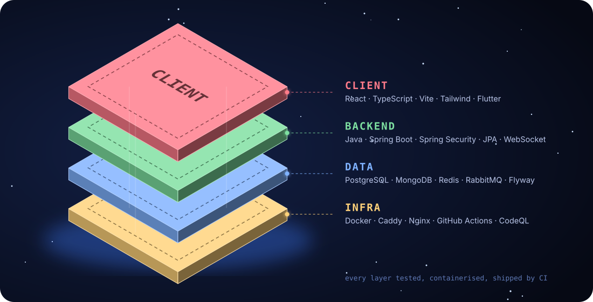

  <br/><br/>

  <br/>
  <br/>
  <br/>
  
</div>

<br/>

<div align="center"></div>

<table>
<tr>
<td width="50%" valign="top">

### 🎯 Correctness first
Invariants get two independent guards — a fast atomic counter and a database lock.
Write APIs take an `Idempotency-Key`, so a retry never double-books or double-charges.

</td>
<td width="50%" valign="top">

### 🧩 Modules by domain
`auth`, `event`, `ticket`, `booking`, `property`… each owns its data and talks through
DTOs and domain events, never through someone else's repository.

</td>
</tr>
<tr>
<td width="50%" valign="top">

### 🔐 Secure by default
Argon2id hashing with transparent BCrypt upgrade, JWT `jti` revocation, persisted
refresh tokens, rate-limited logins and OTP stores that fail **closed**.

</td>
<td width="50%" valign="top">

### 🧪 Test against the real thing
Testcontainers for PostgreSQL and Redis, path-filtered CI, CodeQL, and load tests for the
paths where a race condition would actually hurt.

</td>
</tr>
<tr>
<td width="50%" valign="top">

### 🚢 Ship with evidence
Docker Compose everywhere, Caddy for TLS, images built once in CI, signed, scanned,
and deployed only by a verified tag — with a backup before every migration.

</td>
<td width="50%" valign="top">

### 📚 Docs are part of the product
ADRs, runbooks and bilingual (EN/VI) READMEs, so setup takes minutes rather than
an afternoon of guessing.

</td>
</tr>
</table>

<br/>

<div align="center"></div>

<div align="center">
  <picture>
    <source media="(prefers-color-scheme: dark)" srcset="./profile-3d-contrib/profile-night-rainbow.svg" />
    <source media="(prefers-color-scheme: light)" srcset="./profile-3d-contrib/profile-gitblue.svg" />
    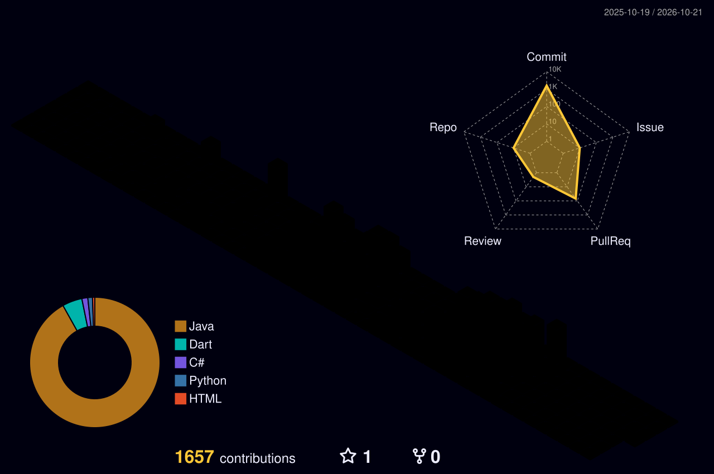
  </picture>

  <br/><br/>

  <picture>
    <source media="(prefers-color-scheme: dark)" srcset="https://raw.githubusercontent.com/trhlow/trhlow/output/github-snake-dark.svg" />
    <source media="(prefers-color-scheme: light)" srcset="https://raw.githubusercontent.com/trhlow/trhlow/output/github-snake.svg" />
    
  </picture>
</div>

<br/>

<div align="center">

**Let's build something that holds up in production.**

<a href="mailto:thlong190705@gmail.com"></a>
<a href="https://github.com/trhlow?tab=repositories"></a>


</div>
