<picture>
  <source media="(prefers-color-scheme: dark)" srcset="./assets/header-dark.svg" />
  <source media="(prefers-color-scheme: light)" srcset="./assets/header-light.svg" />
  
</picture>

Xin chào! I'm Long, an IT student at Tra Vinh University. I build backends, mostly with Java and
Spring Boot, and I enjoy the hard parts: concurrency, auth, messaging and deployment.

## Projects

### [TVU Event & Ticket](https://github.com/trhlow/TVU-Event-Ticket)

Event management and e-ticketing for the student clubs of Tra Vinh University. Seats cannot be oversold: the load test
approves 500 registrations concurrently against 100 seats and requires exactly 100 tickets.

<picture>
  <source media="(prefers-color-scheme: dark)" srcset="./assets/seats-dark.svg" />
  <source media="(prefers-color-scheme: light)" srcset="./assets/seats-light.svg" />
  
</picture>

Tickets go out through a transactional outbox and RabbitMQ as signed QR codes that scan exactly once. Releases are built
once in CI, scanned, signed with Sigstore and deployed only by a verified tag.

`Java 25` `Spring Boot 4` `React 19` `PostgreSQL` `Redis` `RabbitMQ`

### [Cambridge Exam Prep](https://github.com/trhlow/cambridge-exam-prep)

Computer-based exam system for the test room of Victory English Centre, covering A2 Key and B1 Preliminary for Schools.
Proctors watch the whole room live: pause a candidate, add time, rewind the listening.

<picture>
  <source media="(prefers-color-scheme: dark)" srcset="./assets/proctor-dark.svg" />
  <source media="(prefers-color-scheme: light)" srcset="./assets/proctor-light.svg" />
  
</picture>

The server owns the exam clock and Safe Exam Browser is checked on every candidate request. Load-tested with 200 concurrent
candidates, on top of 353 backend tests, 91 frontend tests and Playwright end-to-end tests.

`C#` `ASP.NET Core` `SignalR` `React` `TypeScript` `MySQL`

### [Công Tín Land](https://github.com/trhlow/TraVinh-Shelter)

Real-estate platform connecting buyers and renters with verified brokers in Tra Vinh, for rooms, houses and land.

<picture>
  <source media="(prefers-color-scheme: dark)" srcset="./assets/street-dark.svg" />
  <source media="(prefers-color-scheme: light)" srcset="./assets/street-light.svg" />
  
</picture>

Viewing requests need an SMS one-time code first, which keeps out spam bookings. Argon2id passwords, revocable JWTs and
Redis-backed rate limiting sit behind domain modules, with flexible listing attributes stored as JSONB.

`Java 25` `Spring Boot 4` `React 19` `PostgreSQL` `Redis`

## Contributions

<picture>
  <source media="(prefers-color-scheme: dark)" srcset="https://raw.githubusercontent.com/trhlow/trhlow/output/github-snake-dark.svg" />
  <source media="(prefers-color-scheme: light)" srcset="https://raw.githubusercontent.com/trhlow/trhlow/output/github-snake.svg" />
  
</picture>

## Stack & contact

<picture>
  <source media="(prefers-color-scheme: dark)" srcset="./assets/ticket-dark.svg" />
  <source media="(prefers-color-scheme: light)" srcset="./assets/ticket-light.svg" />
  
</picture>

Scan the ticket, or write to [thlong190705@gmail.com](mailto:thlong190705@gmail.com).
