[English](https://github.com/trhlow) · **Tiếng Việt**

<picture>
  <source media="(prefers-color-scheme: dark)" srcset="./assets/vi/header-dark.svg" />
  <source media="(prefers-color-scheme: light)" srcset="./assets/vi/header-light.svg" />
  
</picture>

Xin chào! Mình là Long, sinh viên Công nghệ Thông tin tại Đại học Trà Vinh. Mình làm backend, chủ yếu với Java và
Spring Boot, và thích những phần khó nhất: xử lý đồng thời, xác thực, hàng đợi tin nhắn và triển khai.

## Dự án

### [TVU Event & Ticket](https://github.com/trhlow/TVU-Event-Ticket)

Hệ thống quản lý sự kiện và vé điện tử cho các câu lạc bộ sinh viên Đại học Trà Vinh. Không thể bán vượt số ghế: bài kiểm thử
tải duyệt đồng thời 500 lượt đăng ký cho 100 ghế và yêu cầu đúng 100 vé.

<picture>
  <source media="(prefers-color-scheme: dark)" srcset="./assets/vi/seats-dark.svg" />
  <source media="(prefers-color-scheme: light)" srcset="./assets/vi/seats-light.svg" />
  
</picture>

Vé được gửi qua transactional outbox và RabbitMQ dưới dạng mã QR có chữ ký, mỗi mã chỉ quét được một lần. Bản phát hành được
build một lần trong CI, quét lỗ hổng, ký bằng Sigstore và chỉ triển khai theo tag đã xác minh.

`Java 25` `Spring Boot 4` `React 19` `PostgreSQL` `Redis` `RabbitMQ`

### [Cambridge Exam Prep](https://github.com/trhlow/cambridge-exam-prep)

Hệ thống thi trên máy cho phòng thi của Trung tâm Anh ngữ Victory, gồm A2 Key và B1 Preliminary for Schools.
Giám thị theo dõi cả phòng theo thời gian thực: tạm dừng thí sinh, cộng giờ, tua lại phần nghe.

<picture>
  <source media="(prefers-color-scheme: dark)" srcset="./assets/vi/proctor-dark.svg" />
  <source media="(prefers-color-scheme: light)" srcset="./assets/vi/proctor-light.svg" />
  
</picture>

Đồng hồ làm bài do server nắm giữ, và Safe Exam Browser được kiểm tra trên mọi yêu cầu của thí sinh. Đã kiểm thử tải với 200 thí sinh
đồng thời, cùng 353 test backend, 91 test frontend và các test đầu-cuối bằng Playwright.

`C#` `ASP.NET Core` `SignalR` `React` `TypeScript` `MySQL`

### [Công Tín Land](https://github.com/trhlow/TraVinh-Shelter)

Nền tảng bất động sản kết nối khách hàng với đội ngũ môi giới đã xác minh tại Trà Vinh, gồm trọ, nhà và đất.

<picture>
  <source media="(prefers-color-scheme: dark)" srcset="./assets/vi/street-dark.svg" />
  <source media="(prefers-color-scheme: light)" srcset="./assets/vi/street-light.svg" />
  
</picture>

Đặt lịch xem nhà phải xác minh mã OTP qua SMS trước, nhờ vậy tránh được lịch hẹn rác. Mật khẩu băm bằng Argon2id, JWT có thể thu hồi và
giới hạn tần suất bằng Redis, tất cả được tổ chức theo domain module, với các thuộc tính linh hoạt của tin đăng lưu ở dạng JSONB.

`Java 25` `Spring Boot 4` `React 19` `PostgreSQL` `Redis`

## Đóng góp

<picture>
  <source media="(prefers-color-scheme: dark)" srcset="https://raw.githubusercontent.com/trhlow/trhlow/output/github-snake-dark.svg" />
  <source media="(prefers-color-scheme: light)" srcset="https://raw.githubusercontent.com/trhlow/trhlow/output/github-snake.svg" />
  
</picture>

## Công nghệ & liên hệ

<picture>
  <source media="(prefers-color-scheme: dark)" srcset="./assets/vi/ticket-dark.svg" />
  <source media="(prefers-color-scheme: light)" srcset="./assets/vi/ticket-light.svg" />
  
</picture>

Quét mã trên vé, hoặc viết cho mình tại [thlong190705@gmail.com](mailto:thlong190705@gmail.com).
